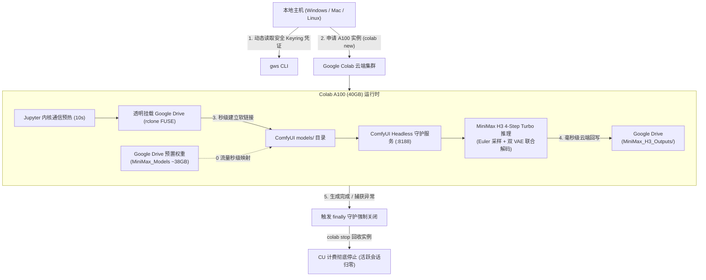

# 🎬 MiniMax H3 Colab Serverless GPU Pipeline

[](https://opensource.org/licenses/MIT)
[](https://www.python.org/)
[](https://pypi.org/project/google-colab-cli/)
[](https://github.com/googleworkspace/cli)

面向 **MiniMax H3（海螺 AI）** 多模态视音频生成模型的**全自动在线 GPU 调度与生成流水线**。  
借助 Google Colab 按需申请 A100 GPU 资源，配合 Google Drive 38GB 模型秒级透明软链接与 ComfyUI Headless 引擎，实现**免人工授权、零带宽重复下载、分钟级出片、任务完毕即刻销毁释放算力**的极简云原生方案。

---

## 🌟 核心特性

- ⚡ **0 带宽模型挂载**：预置在 Google Drive 中的 38GB 核心量化模型（FP8 + NVFP4）通过 FUSE 虚拟文件系统**1 秒内秒级软链接**，免去数十 GB 的长时间下载。
- 🔓 **0 人工授权弹窗**：通过本地 `gws` Keyring 凭据在远端动态建立透明挂载，**彻底根治无头（Headless）环境下 `drive.mount()` 的控制台死锁**。
- 🛡️ **0 CU 资源泄漏**：严格的生命周期上下文守护（`try...finally` 结构），无论任务成功、网络超时或手动中断（Ctrl+C），均无条件触发 `colab stop` 彻底回收 GPU，杜绝后台持续扣费。
- ⏱️ **4-Step Turbo 极速推理**：整合 MiniMax H3 4-step Turbo LoRA，A100 SXM4 单卡仅需 **40 秒左右** 即可完成 24fps 原生立体声音视频同步渲染。
- ☁️ **云端闭环直存**：生成视频毫秒级回写落盘至 Google Drive `MiniMax_H3_Outputs/` 目录，无需落地本地，断连不丢件。
- 🌍 **全平台跨系统即用**：自适应 Windows (`.cmd` / `.exe`)、Linux 与 macOS 路径寻址，开箱即用。

---

## 🏗️ 架构拓扑流程



---

## 📦 Google Drive 云端模型目录结构规范

在首次运行前，请确保您的个人 Google Drive 根目录包含以下模型资产（子目录及文件名需严格对齐）：

```text
Google Drive/
├── 📂 MiniMax_Models/
│   ├── 📂 diffusion_models/
│   │   └── minimax_h3_fl2va_pruned_fp8_scaled.safetensors (~19.5 GB)
│   ├── 📂 text_encoders/
│   │   └── qwen3vl_32b_minimax_h3_nvfp4_awq.safetensors (~14.6 GB)
│   ├── 📂 loras/
│   │   └── minimax_h3_fl2v_turbo_4step_v1.0_768p_comfyui_bf16.safetensors (~1.8 GB)
│   └── 📂 vae/
│       ├── minimax_h3_video_vae_int8_convrot.safetensors (~2.6 GB)
│       └── minimax_h3_audio_vae_fp32.safetensors (~577 MB)
└── 📂 MiniMax_H3_Outputs/  <-- (生成的视频将自动落盘于此)
```

---

## 🚀 快速上手（更换机器 3 步迁移）

无论换到哪台电脑（Windows / macOS / Linux），仅需 3 步即可跑通：

### 步骤 1：安装官方依赖 CLI

```bash
# 1. 安装 Google Colab CLI
pip install google-colab-cli
# 或者使用 uv: uv tool install google-colab-cli

# 2. 安装 Google Workspace CLI
npm install -g @googleworkspace/cli
```

### 步骤 2：完成一次性账号鉴权（单机仅需一次）

```bash
# 授权 Colab 计算配额 (可通过 gcloud 或 oauth2)
colab usage

# 授权 Google Drive 读写权限 (将自动唤起浏览器并存储至本地 Keyring)
gws auth login
```

### 步骤 3：启动自动化工作流

```bash
# 1. 先执行 Dry-run 预检（校验本地 CLI、Drive 凭据与 CU 余额，0 成本）
python pipeline_scheduler.py --dry-run

# 2. 正式执行方案 C：全维度极限压力测试（8 支全风格、多步数、极限时长矩阵测试）
python pipeline_scheduler.py

# 3. 自定义运行指定任务（例如仅跑 Task 1 和 Task 2）
python pipeline_scheduler.py --task-ids 1,2
```

---

## 🧪 评测方案 C（全维度压力测试任务矩阵）

内置在 [`plan_c_tasks.json`](plan_c_tasks.json) 中，包含 8 个针对 MiniMax H3 多模态能力的高难度测试用例：

| ID | 任务名称 | 风格/测试维度 | 配置 (时长/步数/LoRA) | 核心考察点 |
| :---: | :--- | :--- | :--- | :--- |
| **1** | `PlanC_01_Cinematic_Portrait` | 电影级超真实人像 | 5.0s / 4-step Turbo | 皮肤毛孔纹理、眼神微光、微表情肌肉与环境呼吸音 |
| **2** | `PlanC_02_Cyberpunk_Rain` | 雨夜赛博朋克光追 | 5.0s / 4-step Turbo | 复杂霓虹地面倒影、雨水流体飞溅、立体声雨声车声 |
| **3** | `PlanC_03_Macro_Nature` | BBC 8K 自然生态微距 | 5.0s / 4-step Turbo | 晨露透镜折射、昆虫复眼、花瓣绒毛与微观自然音 |
| **4** | `PlanC_04_Auto_Commercial` | 商业奢华超跑广告 | 5.0s / 4-step Turbo | 钛合金与碳纤维材质、V8 引擎排气声浪与商业剪辑节奏 |
| **5** | `PlanC_05_Anime_Fantasy` | 日系二次元奇幻张力 | 5.0s / 4-step Turbo | 动漫关键帧爆发、粒子流体与日系交响配乐 |
| **6** | `PlanC_06_Cinematic_Quality_8step` | 画质阶梯对比 | 5.0s / 8-step Turbo | 与 Task 1 同 Seed 对比 8 步微调对人像细节的提升 |
| **7** | `PlanC_07_Cyberpunk_BaseModel_20step` | 顶级画质无 LoRA 基模 | 5.0s / 20-step 基模 | 与 Task 2 同 Seed 对比基模无 LoRA 20 步精细光影渲染 |
| **8** | `PlanC_08_Stress_10s_Space_Opera` | 极限时长压力测试 | 10.0s / 4-step Turbo | 243 帧连续多机位太空歌剧史诗，测试长时间空间一致性 |

---

## ⚙️ 核心脚本说明

- [`pipeline_scheduler.py`](pipeline_scheduler.py)：**跨平台总调度器**。负责动态读取任务配置、分配 A100 实例、预热通信信道、投递代码、捕获进度日志，并在 `finally` 阶段无条件执行 `colab stop` 回收算力。
- [`remote_minimax_runner.py`](remote_minimax_runner.py)：**远端执行流水线**。运行在 Colab A100 容器内，执行 rclone 透明挂载、秒级软链接、ComfyUI 依赖部署、构建真实 API Prompt 并监听渲染进度，实时回传 Google Drive。
- [`plan_c_tasks.json`](plan_c_tasks.json)：方案 C 的 8 个结构化测试任务定义。
- [`inspect_drive.py`](inspect_drive.py)：Drive 模型与输出目录资产快捷探测工具。

---

## 📊 成本与耗时参考

- **硬件费率**：Colab NVIDIA A100 约 12~13 Compute Units (CU) / 小时。
- **单次测试耗时**：端到端约 **1.8 ~ 2.0 分钟**（其中挂载与软链接 2 秒，4-Step Turbo 推理采样 40 秒）。
- **单次 CU 消耗**：实测仅消耗约 **0.3 ~ 0.5 CU**（单次测试花费不到 0.05 美元），极度经济高效。

---

## 🔒 安全说明（Security Policy）

- 本项目遵循最小权限与零明文存储原则。
- **严禁向 GitHub 提交 `logs/` 目录**。调试日志可能在异常回溯中记录临时 Token，本项目已在 [`.gitignore`](.gitignore) 中默认将所有日志和临时凭证全面屏蔽。

---

## 📄 许可证

本项目基于 [MIT License](LICENSE) 开源。相关模型权重及依赖遵循其原作者的开源许可协议。
